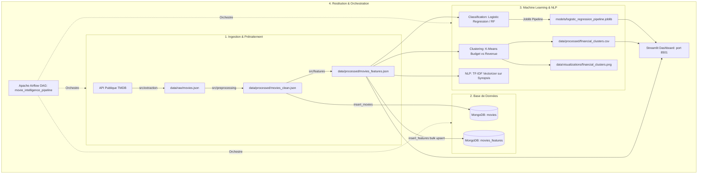

# 🎬 Movie Intelligence
> **Analyse intelligente, Classification, Clustering et Pipeline MLOps automatisé pour catalogue de films (TMDB)**

[](https://www.python.org/)
[](https://airflow.apache.org/)
[](https://www.docker.com/)
[](https://www.mongodb.com/)
[](https://streamlit.io/)
[](https://scikit-learn.org/)
[](https://bouchaibelhaidi96.atlassian.net/jira/software/c/projects/MOV/boards/2/backlog)

---

## 📌 Présentation du Projet

**Movie Intelligence** est une solution bout-en-bout d'ingénierie de données et d'intelligence artificielle conçue pour exploiter le catalogue de films de l'API publique **The Movie Database (TMDB)**.

Le système orchestre l'ensemble du cycle de vie des données :
1. **Extraction automatisée** de données riches (métadonnées structurées et résumés textuels).
2. **Nettoyage et validation** (types, valeurs manquantes, déduplication, conversions temporelles).
3. **Feature Engineering avancé** (durées catégorisées, compteurs de genres/mots-clés, filtrage des valeurs aberrantes).
4. **Stockage NoSQL multi-collections** sur **MongoDB**.
5. **Modélisation Machine Learning** :
   - **Classification binaire supervisée** : Détection du niveau d'engagement / popularité du film avec validation croisée stratifiée (`StratifiedKFold`) et optimisation d'hyperparamètres (`GridSearchCV`).
   - **Clustering non supervisé (K-Means)** : Segmentation financière des films (Budget vs Revenue) avec visualisations.
   - **Traitement NLP (TF-IDF)** : Vectorisation et analyse lexicale des synopsis (`overview`).
6. **Orchestration MLOps (Apache Airflow)** : Pipeline DAG automatisé de bout en bout avec dépendances ordonnées et exécution parallèle des modèles.
7. **Tableau de bord interactif (Streamlit)** : Visualisation des métriques, exploration du catalogue, inférence du modèle de classification et cartographie des clusters financiers.

---

## 🏗️ Architecture du Système



---

## 📂 Structure du Répertoire

```bash
Movie-Intelligence/
├── dags/
│   └── movie_intelligence_pipeline.py # DAG Airflow de production automatisé
├── dashboard/
│   └── app.py                        # Application Web interactive Streamlit
├── data/
│   ├── processed/                    # Données nettoyées, enrichies et clusters
│   │   ├── financial_clusters.csv
│   │   ├── movies_clean.json
│   │   └── movies_features.json
│   ├── raw/                          # Données brutes issues de TMDB
│   │   └── movies.json
│   └── visualizations/               # Graphiques générés (clusters, distributions)
│       └── financial_clusters.png
├── models/                           # Pipelines et modèles scikit-learn sérialisés
│   └── logistic_regression_pipeline.joblib
├── notebooks/
│   └── EDA.py                        # Analyse Exploratoire des Données (EDA)
├── src/
│   ├── classification/               # Entraînement, validation croisée, tuning
│   │   ├── classification.py
│   │   ├── save_model.py
│   │   ├── tuning.py
│   │   └── validation.py
│   ├── clustering/                   # K-Means financier Budget vs Revenue
│   │   └── clustering.py
│   ├── database/                     # Connexion et bulk upsert MongoDB
│   │   └── mongodb.py
│   ├── extraction/                   # Client HTTP API TMDB
│   │   └── tmdb_api.py
│   ├── features/                     # Feature engineering & détection d'outliers
│   │   └── feature_engineering.py
│   ├── nlp/                          # Vectorisation TF-IDF sur résumés textuels
│   │   └── tfidf.py
│   └── preprocessing/                # Nettoyage, typage, déduplication
│       └── cleaning.py
├── .dockerignore                     # Exclusions des contextes Docker
├── .env.example                      # Template des variables d'environnement
├── .gitignore                        # Exclusions de suivi Git
├── Dockerfile                        # Image Docker du Dashboard Streamlit
├── Dockerfile.airflow                # Image Docker d'Airflow avec dépendances
├── docker-compose.yml                # Orchestration des conteneurs (MongoDB, Airflow, App)
├── requirements.txt                  # Dépendances Python de production
└── README.md                         # Documentation officielle du projet
```

---

## ⚙️ Prérequis

- **Python** : 3.10 ou supérieur (testé sur 3.11, 3.12, 3.13)
- **Docker & Docker Compose** : (recommandé pour déploiement immédiat)
- **Compte TMDB** : Clé API ou Jeton d'accès Read v4 ([themoviedb.org](https://www.themoviedb.org/))

---

## 🚀 Démarrage Rapide

### Option A : Déploiement Complet via Docker (Recommandé)

1. **Cloner le projet :**
   ```bash
   git clone https://github.com/BOUCHAIB-EL-HAIDI/A2_S1_B3_Movie_Intelligence.git
   cd A2_S1_B3_Movie_Intelligence
   ```

2. **Créer le fichier `.env` :**
   ```bash
   cp .env.example .env
   # Renseignez votre clé TMDB_API_KEY dans le fichier .env
   ```

3. **Lancer la stack complète :**
   ```bash
   docker compose up --build -d
   ```

4. **Accéder aux interfaces :**
   - 📊 **Dashboard Streamlit** : [http://localhost:8501](http://localhost:8501)
   - 🔄 **Apache Airflow UI** : [http://localhost:8080](http://localhost:8080) *(login/mot de passe affichés dans les logs ou configurés en standalone)*
   - 🍃 **MongoDB** : `localhost:27017`

---

### Option B : Installation Locale

1. **Créer et activer un environnement virtuel :**
   ```bash
   python -m venv .venv
   # Sur Windows (PowerShell) :
   .\.venv\Scripts\Activate.ps1
   # Sur Linux / macOS :
   source .venv/bin/activate
   ```

2. **Installer les dépendances :**
   ```bash
   pip install -r requirements.txt
   ```

3. **Configurer les variables d'environnement :**
   Créer un fichier `.env` à la racine :
   ```env
   TMDB_API_KEY=votre_cle_api_tmdb
   TMDB_PAGES_TO_EXTRACT=5
   MONGODB_URI=mongodb://localhost:27017
   ```

4. **Lancer les modules pas à pas :**
   ```bash
   # 1. Extraction TMDB
   python -m src.extraction.tmdb_api

   # 2. Nettoyage des données
   python -m src.preprocessing.cleaning

   # 3. Feature Engineering
   python -m src.features.feature_engineering

   # 4. Insertion MongoDB
   python -m src.database.mongodb

   # 5. Entraînement de la Classification
   python -m src.classification.save_model

   # 6. Clustering K-Means
   python -m src.clustering.clustering

   # 7. Analyse TF-IDF
   python -m src.nlp.tfidf

   # 8. Lancement du Dashboard
   streamlit run dashboard/app.py
   ```

---

## 🤖 Pipeline de Machine Learning

### 1. Classification Supervisée (`src/classification`)
- **Objectif** : Prédire si un film atteindra un niveau d'engagement élevé (haut volume de votes).
- **Algorithmes évalués** : Régression Logistique, Random Forest.
- **Validation** : `StratifiedKFold` (5 folds) pour préserver l'équilibre des classes.
- **Métriques d'évaluation** : Accuracy, F1-score, Precision, Recall, Matrice de Confusion, ROC-AUC.
- **Optimisation** : `GridSearchCV` pour trouver les meilleurs hyperparamètres de régularisation.
- **Persistance** : Modèle sérialisé et réutilisable dans `models/logistic_regression_pipeline.joblib`.

### 2. Clustering Financier K-Means (`src/clustering`)
- **Objectif** : Identifier des groupes homogènes de rentabilité et d'investissement (Budget vs Box-office).
- **Prétraitement** : Mise à l'échelle standard (`StandardScaler`) et traitement des asymétries logarithmiques.
- **Livrables** : Dataset segmenté (`financial_clusters.csv`) et graphique comparatif (`financial_clusters.png`).

### 3. Traitement NLP (`src/nlp`)
- **Objectif** : Extraire les termes caractéristiques des synopsis de films.
- **Méthode** : `TfidfVectorizer` (filtrage des stop words, limitation du vocabulaire aux n-grammes significatifs).

---

## 🔄 Orchestration Apache Airflow

Le DAG `movie_intelligence_pipeline` ([dags/movie_intelligence_pipeline.py](dags/movie_intelligence_pipeline.py)) gère l'exécution séquentielle et parallèle des étapes :

```
[extract_tmdb_data]
         ↓
    [clean_data]
         ↓
[feature_engineering]
         ↓
  [store_in_mongodb]
         ↓
   ┌─────────────────────────────┬──────────────────┐
   ↓                             ↓                  ↓
[train_classification_model]  [run_clustering]   [run_nlp_tfidf]
```

- **Tolérance aux pannes** : En cas d'indisponibilité du réseau TMDB, la tâche d'extraction bascule automatiquement sur les données locales existantes.
- **Idempotence** : Le stockage MongoDB utilise un `bulk_write` avec `UpdateOne(..., upsert=True)` pour éviter tout doublon lors des réexécutions.

---

## 📊 Application Dashboard Streamlit

L'interface utilisateur interactive ([dashboard/app.py](dashboard/app.py)) offre :
- **Overview** : KPI globaux (nombre de films, distribution des langues, notes moyennes, top genres).
- **Classification & Inférence** : Sélection d'un film pour estimer et visualiser son score d'engagement.
- **Clusters Financiers** : Exploration interactive des groupes budgétaires, projections 2D dynamiques et diagrammes de répartition.

---

## 📋 Gestion de Projet & Suivi Agile (Jira)

- **Tableau Jira (Backlog & Sprints)** : [Jira Software - Projet MOV](https://bouchaibelhaidi96.atlassian.net/jira/software/c/projects/MOV/boards/2/backlog)
- **Fichier d'importation du backlog** : [`jira_backlog_import.csv`](jira_backlog_import.csv) (contenant les 4 Epics, 13 User Stories, Story Points et critères d'acceptation du référentiel RNCP).

---

## 👥 Auteur & Remerciements

- **Auteur** : Bouchaib EL HAIDI ([GitHub: BOUCHAIB-EL-HAIDI](https://github.com/BOUCHAIB-EL-HAIDI))
- **Données** : Fournies par l'API [The Movie Database (TMDB)](https://www.themoviedb.org/).
